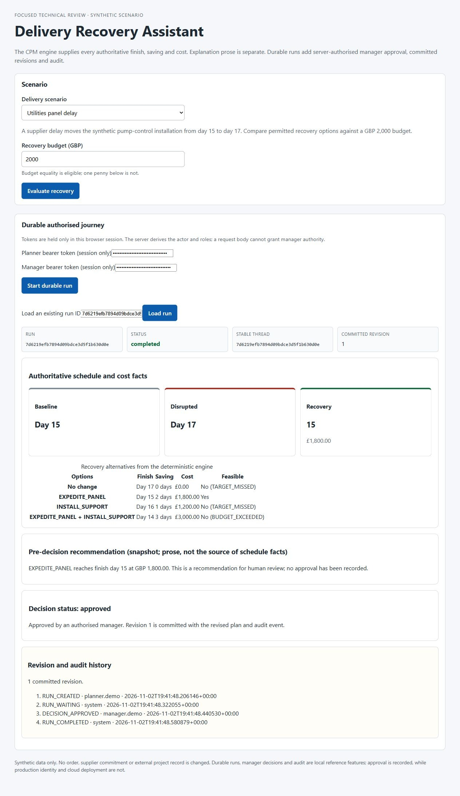

# Delivery Recovery Assistant

**Explain a delivery delay, compare permitted recovery options, and commit a manager-approved plan with an audit trail.**

An engineering portfolio project by Koate Kpai, built on the `multi-agent-optimizer` Critical Path Method engine. It combines deterministic scheduling, LangGraph orchestration, human approval, React and a bounded AWS recovery demonstration.

> Synthetic interview reference. Code computes scheduling and cost facts; the model explains verified facts. Current persistence is single-instance SQLite development. PostgreSQL test is planned; production is outside the delivered scope.

## The business decision

A panel-supply delay moves a pump-control installation from **day 15 to day 17**. The planner has a **£2,000 budget**:

| Permitted option | Finish | Cost | Result |
|---|---:|---:|---|
| No intervention | day 17 | £0 | Misses target |
| Expedite panel | day 15 | £1,800 | Feasible recommendation |
| Installation support | day 16 | £1,200 | Misses target |
| Both interventions | day 14 | £3,000 | Over budget |

Every candidate is recomputed. Approval binds the project version, input hash and catalogue hash; decision, revision and audit are recorded atomically. No procurement or external project-system update occurs.

<details>
<summary>View the synthetic approval, committed revision and audit trail</summary>



</details>

## Reviewer guide

- **[Start here: five-minute engineering tour](docs/portfolio/START_HERE.md)**
- [Architecture and decisions](docs/portfolio/ARCHITECTURE.md)
- [Business case and success scenarios](docs/portfolio/BUSINESS_CASE.md)
- [Quality requirements and evidence](docs/portfolio/QUALITY_AND_EVIDENCE.md)
- [45-minute demonstration](docs/portfolio/DEMO_GUIDE.md)
- [Preserved audit trail and provenance](docs/portfolio/PROVENANCE.md)

## Run locally

Python 3.12+, Node.js 24 and npm. Default mode uses a labelled synthetic provider: no API keys, AWS account or paid calls.

```bash
python -m venv .venv
# Windows PowerShell: .\.venv\Scripts\Activate.ps1
# macOS/Linux: source .venv/bin/activate
python -m pip install -e ".[dev,langgraph]"
npm --prefix web ci
npm --prefix web run build
python scripts/run_phase3_demo.py --port 8000
```

Open **http://127.0.0.1:8000/ui/**. API docs: **http://127.0.0.1:8000/docs**; readiness: **/readyz**. The app prints the local identity-file location. Paste its generated planner/manager tokens into their respective UI fields. Keep token values out of screenshots and commits. These demo identities are not enterprise federation.

Optional container route: `docker compose up --build`, then `docker compose down`. Data remains in `var/container-data`; builds download images/packages. AWS scripts are not needed for the local demo.

## Verify

```bash
python -m pytest
python evals/evaluate.py
npm --prefix web test
npm --prefix web run build
```

[Validation results](docs/portfolio/VALIDATION.md) distinguish publication reruns from historical evidence. CI targets Python 3.12/Ubuntu; a Windows result is not a Linux CI pass.

## Demonstrated engineering

- Deterministic feasibility, permitted changes and complete schedule recomputation.
- Bounded graph execution, validated explanations and visible provider fallback.
- Durable jobs/checkpoints, project authorization and principal-scoped idempotency.
- Version-bound manager approval, atomic revision/audit and process recovery.
- Historical native ARM64 AWS restore/switch/restart verification and terminal rollback.
- Project billable AWS resources removed on **5 November 2026**. Cloud images are historical; no always-on AWS service is claimed.

## Limits and roadmap

No scale-out, HA, host/volume-loss recovery, enterprise federation or production deployment claim. PostgreSQL is the next test-environment stage. Frozen holdout evaluation, production load profile and AWS recreation rehearsal remain uncompleted. Historical container findings were recorded; any new deployment needs a current scan/disposition.

The original audit branch and full history remain private and unchanged. This branch is a curated derivative with reviewed images and explicit provenance. [MIT licence](LICENSE).
