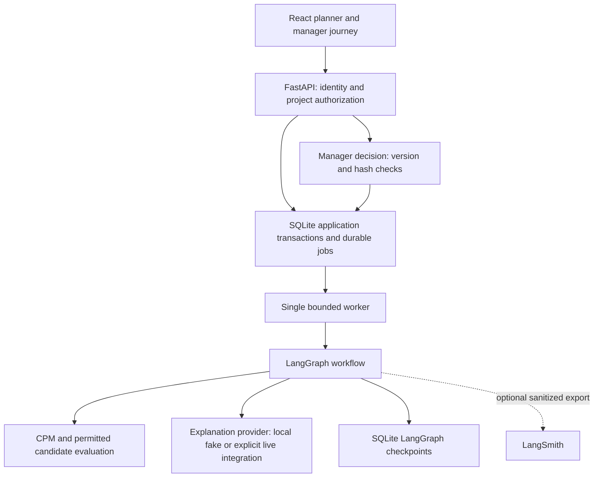

# Architecture and decisions

## Authority

CPM owns schedule facts. Candidate policy owns permitted changes, costs, compatibility and ranking. The model explains results and requests allowed tools; it cannot grant permissions, relax constraints or approve a revision. Structured validation checks explanation facts.

Browser tokens map to server-side roles/project scope. Access is checked before persistence or idempotency lookup; a request actor cannot grant manager authority. This demonstrates local authorization behavior. Federation and production TLS ingress are separate future work.

## Persistence and concurrency

Submission persists a job before HTTP202. A bounded worker leases jobs; human waits release the lease. Application state is in `application.db`, graph checkpoints in `checkpoints.db`. Approval validates version, input and catalogue hashes, then advances authoritative version and records decision/revision/audit in an application transaction. Principal-scoped idempotency and reconciliation address replay and the commit-before-checkpoint crash window.

These two SQLite stores are not a distributed transaction. Recovery logic reconciles their boundary. Process-restart success does not establish cross-host durability or multiple-worker scalability.

## Database decision

SQLite was selected for a reproducible single-instance development reference with transactional tests and little operational overhead. PostgreSQL is the agreed next **test environment**: migrations, checkpoints, concurrency and consistent backup/restore must be implemented and verified there. No production cluster is implemented. Database environment phases are separate from original delivery phases.

## AWS reference

Historical deployment used native ARM64 `t4g.medium`, encrypted 10GB root/20GB data disks, ECR identity, SSM operations and CloudWatch logs. The bounded recovery experiment exported synthetic data, restored to a new directory, switched active, verified contents, recreated the service, reverified and rolled back. The instance was stopped; all project billable resources were subsequently removed.

This proves the recorded restore/switch/controlled-restart/rollback path on surviving infrastructure. It does not prove host/volume-loss recovery, HA, spontaneous crash, snapshot recovery or AWS recreation. Recorded image findings require fresh assessment before redeployment.

`infra/` and `scripts/phase4_*` retain reference tooling. Live state, policies rendered for a real account and approval receipts are private. Historical runbooks can refer to private orchestration assets: they are design context, not executable approval or a turnkey cloud guide.
